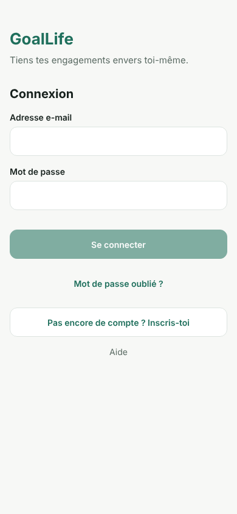
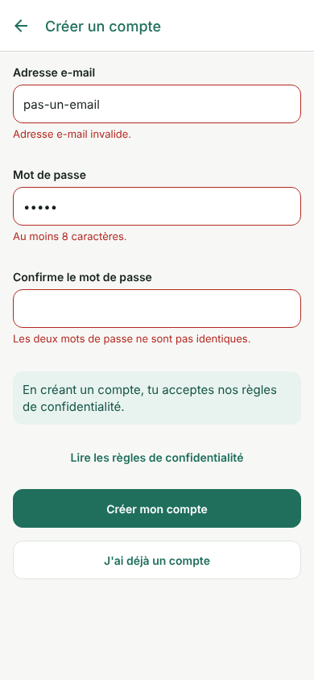
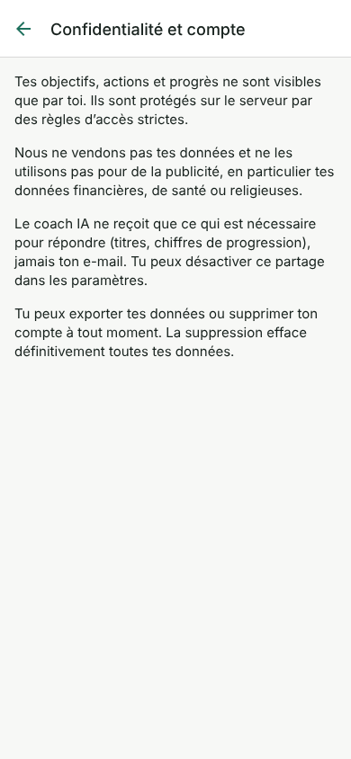

# GoalLife (nom provisoire)

Application mobile qui aide chacun à **tenir ses engagements envers lui-même** : on fixe un
objectif, l'application le transforme en petites actions réalistes, rappelle, suit la
progression réelle et aide à **reprendre sans culpabiliser** après un retard.
Pensée d'abord pour le Cameroun (FCFA, Android d'entrée de gamme, réseau instable, français puis anglais).

Le nom se change sans toucher au code : variable `APP_NAME` (voir `.env.example`).

<p>



</p>

---

## 1. Ce qui fonctionne réellement (vérifié le 22/10/2026)

| Vérification | Commande | Résultat |
|---|---|---|
| TypeScript strict | `npm run typecheck` | ✅ aucune erreur |
| Lint (règles Expo) | `npm run lint` | ✅ aucune erreur |
| Logique métier (plans, progression, fuseaux, récurrences, reprise, offres, rappels, validation, modèles, estimation) | `npm test` | ✅ 62 tests |
| Base de données : RLS, isolation entre utilisateurs, limites Premium côté serveur, double validation, report, reprise, quotas IA, suppression de compte | `npm run test:db` | ✅ 61 + 14 vérifications (dont module candidatures) sur un PostgreSQL 16 local qui imite Supabase |
| Fonctions serveur (coach IA, suppression de compte, webhook) | `deno check` + `deno test` | ✅ types OK, 6 tests |
| Bundle Android (Hermes) | `npx expo export --platform android` | ✅ 4,8 Mo |
| Démarrage réel dans un navigateur : connexion, erreur de mot de passe, validation de l'inscription, confidentialité | Playwright + export web | ✅ (captures ci-dessus) |

**Jamais testé à ce jour** (demande tes comptes ou un téléphone) :
- avec un **vrai projet Supabase** (inscription, e-mail de confirmation, lien « mot de passe oublié ») ;
- sur un **vrai téléphone** Android/iPhone (rendu, notifications, hors connexion) ;
- avec une **vraie clé d'IA** (le code a passé la vérification de types avec le SDK officiel, mais aucun appel réel n'a été fait) ;
- le parcours complet après connexion (création d'objectif, plan, actions…) n'a été vérifié
  qu'au niveau de la logique et de la base, **pas en cliquant dans l'application**, faute de serveur Supabase.

## 2. Architecture

```
Application Expo (React Native, TypeScript)
   │  clé PUBLIQUE uniquement ; toute la sécurité est appliquée côté serveur
   ▼
Supabase
   ├─ Auth (e-mail + mot de passe, liens par e-mail en PKCE)
   ├─ PostgreSQL + RLS (chaque ligne appartient à un utilisateur)
   │    └─ fonctions SQL atomiques : créer un objectif + son plan, changer le statut d'une
   │       action, reprise après retard, modifier le rythme, quotas IA
   └─ Edge Functions (Deno) — seules à détenir des secrets
        ├─ coach              : IA (fournisseur remplaçable), quotas, contexte minimal
        ├─ supprimer-compte   : suppression définitive (clé service role)
        └─ webhook-abonnement : seul chemin pour devenir Premium (RevenueCat)
```

Choix principaux :
- **Expo SDK 58 + Expo Router** (navigation par fichiers, gardes `Stack.Protected`).
- **TanStack Query** avec cache persistant : affichage hors connexion et file d'attente des
  validations d'actions (voir `docs/hors-connexion.md`).
- **zod** pour la validation ; formulaires simples en état React (pas de bibliothèque de
  formulaires : les formulaires sont courts, une dépendance de plus n'apportait rien).
- **Pas de bibliothèque de composants externe** : un petit système de design maison
  (`src/theme`, `src/components`) cohérent, accessible (zones tactiles ≥ 44 px, rôles
  d'accessibilité) et léger pour les Android modestes.
- **Pas de sélecteur de date natif** : choix de durées (« 30 jours ») et d'heures par pas de
  15 min, plus simples à utiliser et sans dépendance native.
- **Rappels locaux** (expo-notifications) programmés sur le téléphone : fonctionnent sans réseau.
  Les notifications push sont préparées (table `jetons_push`) mais facultatives.

## 3. Structure

```
src/app/                  écrans (Expo Router)
  _layout.tsx             fournisseurs, écran de démarrage, gardes de navigation
  (auth)/                 connexion, inscription, mot de passe oublié
  auth-retour.tsx         liens reçus par e-mail ; reinitialiser.tsx : nouveau mot de passe
  onboarding.tsx          5 questions courtes, toutes facultatives
  (onglets)/              Accueil, Objectifs, Mon Coach, Progression, Profil
  objectifs/nouveau.tsx   formulaire -> plan modifiable -> activation
  objectifs/[id]/         détail, modifier, reprise après retard
  actions/[id].tsx        faire, reporter, ignorer, annuler, modifier, créer
  candidatures/            suivi des candidatures (liste, formulaire)
  planning, calendrier, historique, parametres, notifications, abonnement, confidentialite, aide
src/domain/               logique métier PURE et testée (aucun accès réseau)
src/data/                 accès Supabase (seul endroit qui parle au serveur)
src/hooks/                hooks de données (TanStack Query), synchronisation de fond
src/offline/              cache persistant, file d'attente hors connexion
src/notifications/        rappels locaux et jeton push
src/i18n/                 tous les textes (fr de référence, en complet)
src/theme/, src/components/  système de design
supabase/migrations/      schéma versionné
supabase/tests/           tests SQL (RLS, logique)
supabase/functions/       Edge Functions + tests Deno
docs/                     règles de calcul, hors connexion, captures
```

## 4. Installation et lancement local

Prérequis : Node.js 20+ (testé avec 22), un compte Supabase, l'application **Expo Go** ou un
build de développement sur un téléphone.

```bash
cd goallife
npm install
cp .env.example .env        # puis remplir EXPO_PUBLIC_SUPABASE_URL et EXPO_PUBLIC_SUPABASE_KEY
npx expo start              # scanner le QR code avec le téléphone
```

> Les notifications et certaines fonctions natives se testent mieux avec un **build de
> développement** : `npx eas-cli@latest build --profile development --platform android`
> (installe un APK sur le téléphone, puis `npx expo start`).

## 5. Configurer Supabase (à faire par toi)

1. Créer un projet sur supabase.com (région proche : `eu-west` ou `eu-central`).
2. **SQL Editor** : exécuter, dans l'ordre, les fichiers de `supabase/migrations/`
   (`20261022000001_schema_initial.sql` puis `20261022000002_modules_metier.sql`).
   (Ou avec la CLI : `npx supabase link` puis `npx supabase db push`.)
3. **Authentication > URL Configuration** : ajouter `goallife://**` dans *Redirect URLs*
   (et l'adresse `exp://…` affichée par Expo Go pendant les tests).
4. **Authentication > Providers > Email** : laisser la confirmation par e-mail activée.
   Configurer un SMTP (ex. Resend) avant la mise en ligne : le SMTP intégré est très limité.
5. **Project Settings > API** : copier l'URL et la clé publique dans `.env`.
   **Ne jamais** mettre la clé `service_role` dans l'application.
6. Fonctions serveur :
   ```bash
   npx supabase functions deploy coach
   npx supabase functions deploy supprimer-compte
   npx supabase functions deploy webhook-abonnement --no-verify-jwt   # appelé par RevenueCat
   cp supabase/functions/.env.example supabase/functions/.env          # remplir
   npx supabase secrets set --env-file supabase/functions/.env
   ```
   Prévoir deux projets Supabase (développement et production) dès que de vrais utilisateurs arrivent.

## 6. Coach IA

- Sans `ANTHROPIC_API_KEY`, tout fonctionne : l'écran « Mon Coach » affiche honnêtement que l'IA
  n'est pas configurée et propose une **analyse automatique** à partir des données réelles.
- Avec une clé : le serveur appelle Claude (SDK officiel `@anthropic-ai/sdk`).
  - **Modèle** : `IA_MODELE`, par défaut `claude-opus-5-5` (le plus capable, ~4 $ / 20 $ par
    million de jetons). Pour un abonnement à 1–3 $/mois, tu voudras sans doute un modèle moins cher :
    `claude-haiku-5-5` (~0,10 $ / 0,50 $) ou `claude-sonnet-5-5`. **C'est ta décision** :
    il suffit de changer la variable, sans toucher au code.
  - Réponses courtes (effort `low` par défaut), refus de sécurité gérés (repli automatique
    côté serveur, puis message honnête si l'IA ne répond pas).
  - Quotas mensuels vérifiés **côté serveur** : 5 questions (gratuit), 150 (Premium) — table `parametres_offres`.
  - Données envoyées : titres, catégories, chiffres de progression et dates. **Jamais** le nom
    ni l'e-mail. L'utilisateur peut couper ce partage dans les paramètres.
- Changer de fournisseur : implémenter l'interface `supabase/functions/_shared/ia/fournisseur.ts`.

## 7. Offre gratuite et Premium

- Limites centralisées dans la table SQL `parametres_offres` (source de vérité) et recopiées dans
  `src/domain/offres.ts` pour l'affichage. Le serveur refuse un 4ᵉ objectif actif en gratuit.
- Gratuit : 3 objectifs actifs, 5 questions IA/mois, statistiques de base.
  Premium : 30 objectifs, 150 questions, statistiques par domaine.
- Le statut Premium n'est **jamais** décidé par le téléphone : seule la fonction
  `webhook-abonnement` (clé secrète) écrit dans `abonnements`.
- **Pas encore de paiement dans l'application** : le bouton « Passer à Premium » explique que
  le paiement n'est pas activé. Étapes pour l'activer :
  1. Créer les produits d'abonnement dans Google Play Console et App Store Connect.
  2. Créer un compte RevenueCat, y relier les deux boutiques, définir l'« entitlement » `premium`.
  3. Ajouter `react-native-purchases` à l'application (build de développement requis),
     appeler `Purchases.logIn(<id utilisateur Supabase>)` après la connexion.
  4. Dans RevenueCat, webhook vers `https://<projet>.supabase.co/functions/v1/webhook-abonnement`
     avec l'en-tête `Authorization: Bearer <WEBHOOK_ABONNEMENT_SECRET>`.
  > Google et Apple imposent leur propre système de paiement pour un abonnement numérique vendu
  > dans l'application. Le Mobile Money (CinetPay) n'est en principe pas autorisé pour cela :
  > à vérifier dans les règles actuelles de Google Play avant de décider.

## 8. Tests

```bash
npm run typecheck   # TypeScript
npm run lint        # ESLint (config Expo)
npm test            # logique métier (Jest)
npm run test:db     # base : lance un PostgreSQL jetable (PostgreSQL 15+ installé requis)
npm run verifier    # tout ce qui précède

# Fonctions serveur (Deno 2 requis)
cd supabase/functions && deno check coach/index.ts supprimer-compte/index.ts webhook-abonnement/index.ts && deno test --allow-env _shared/
```

## 9. Builds et publication (demande tes comptes)

```bash
npx eas-cli@latest login
npx eas-cli@latest init                                         # crée le projet EAS -> EAS_PROJECT_ID
npx eas-cli@latest build --profile preview --platform android   # APK à installer pour tester
npx eas-cli@latest build --profile production --platform all    # versions pour les boutiques
npx eas-cli@latest submit --platform android
```

À faire avant publication : compte Google Play (25 $ une fois), compte Apple Developer (99 $/an),
icône et écran de démarrage définitifs (`assets/`), politique de confidentialité publiée en ligne
(le texte de l'écran Confidentialité est un résumé, pas un document juridique), fiche de sécurité
des données Google Play, notifications push : clés FCM (Android) et APNs (iOS) dans EAS.

## 10. Ce qui demande ton intervention

- Créer le projet Supabase et remplir `.env` (section 5).
- Choisir le **modèle d'IA** et fournir une clé Anthropic (section 6), ou laisser le coach sans IA.
- Décider du **prix** et des limites gratuit/Premium (table `parametres_offres`).
- Créer les comptes boutiques, EAS et RevenueCat.
- Vérifier les obligations légales au Cameroun (protection des données personnelles, âge minimum).
- Tester sur un vrai téléphone Android d'entrée de gamme.

## 11. Limites connues

- Pas de connexion Google/Apple/téléphone pour l'instant (l'architecture Supabase Auth le permet).
- Créer un objectif demande Internet (le reste du suivi quotidien fonctionne hors ligne).
- Modules métier : 23 modèles d'objectifs, suivi des candidatures et estimation de la date
  d'atteinte sont en place. Restent à faire : budgets mensuels, rappels de médicaments,
  rappel automatique de relance des candidatures (aujourd'hui : simple badge « À relancer »),
  partage familial.
- Pas de limitation de débit spécifique sur l'inscription/connexion au-delà de celle de Supabase Auth.
- La version web sert aux tests ; les rappels n'y sont pas disponibles.
- Export des données : JSON partagé via la feuille de partage du téléphone (pas de fichier).
